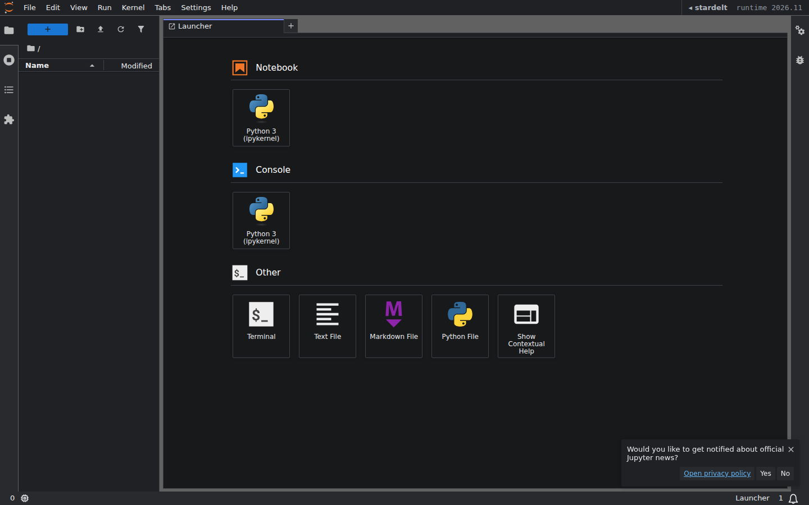
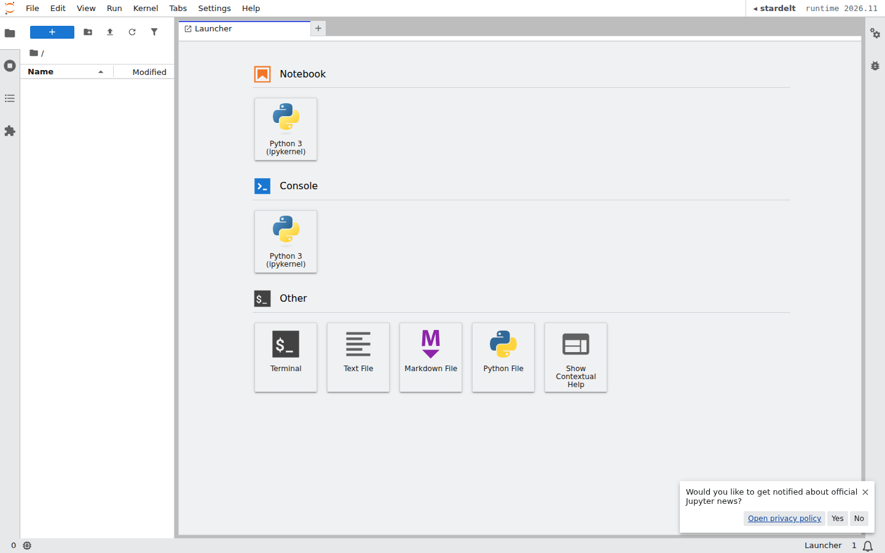

# stardelt_jupyterlab

[](https://github.com/stardelt/stardelt-python/actions/workflows/build.yml)

stardelt inside JupyterLab: theme, top bar, catalog, publish

This extension is composed of a Python package named `stardelt_jupyterlab`
for the server extension and a NPM package named `@stardelt/jupyterlab`
for the frontend extension.

## What it adds

- **Themes**: `stardelt Graphite` (dark, the default) and `stardelt Silver`
  (light). Pick one under _Settings → Theme_.

  | stardelt Graphite                       | stardelt Silver                     |
  | --------------------------------------- | ----------------------------------- |
  |  |  |

- **Top bar**: `◂ stardelt` links back to Nova, then the user and the runtime
  label. The server extension puts them into the page config from the
  environment, so start JupyterLab with:

  ```bash
  STARDELT_NOVA_URL=https://alpha.dev.stardelt.io STARDELT_RUNTIME=2026.11 jupyter lab
  ```

  `stardeltNovaUrl` is empty when `STARDELT_NOVA_URL` is unset, and the link is
  then left out; the same for the runtime label and `STARDELT_RUNTIME`.

## Default theme

`overrides.json` in this directory selects `stardelt Graphite` for a new user.
It only takes effect where it is copied into the JupyterLab settings
directory. The notebook image installs it as
`$CONDA_DIR/share/jupyter/lab/settings/overrides.json` (stardelt-platform);
this package does not install it.

## Requirements

- JupyterLab >= 4.0.0

## Install

To install the extension, execute:

```bash
pip install stardelt_jupyterlab
```

## Uninstall

To remove the extension, execute:

```bash
pip uninstall stardelt_jupyterlab
```

## Troubleshoot

If you are seeing the frontend extension, but it is not working, check
that the server extension is enabled:

```bash
jupyter server extension list
```

If the server extension is installed and enabled, but you are not seeing
the frontend extension, check the frontend extension is installed:

```bash
jupyter labextension list
```

## Contributing

If you would like to contribute to this extension, please refer to the [Contributing Guide](CONTRIBUTING.md).
